# Formula 1 Podium Prediction
Milestone 1 analytical report | 1950-2024 source, 2003-2024 modeling

## Executive summary

A driver-race starter is predicted to finish on the podium using only data available after qualifying and before the race. The selected Logistic regression scored test PR-AUC 0.709, ROC-AUC 0.936, F1 0.669, precision 0.579, and recall 0.794 on unseen 2022-2024 races. PR-AUC is primary because podiums are uncommon; the F1 threshold was chosen on 2020-2021 validation data.

This report reproduces the notebook's three relational analyses, audit and cleaning evidence, feature rationale, all model comparisons, controlled experiments, model explanations and limitations. The notebook is the executable source of truth.

## 1. Data audit and cleaning

The immutable source contains 14 linked CSV tables and 26,759 results rows across 1950-2024. Literal missing markers were converted to nulls; dates, numeric columns and lap/pit durations were typed, with parse failures and key checks recorded in the notebook. Qualifying coverage was 11.6% in 2002 and 100.0% in 2003, supporting the 2003 modeling start. Primary keys were checked for uniqueness and non-null values; foreign keys for orphans.

The cleaning rules removed 405 Indianapolis 500 rows, 1,739 non-starters, and 64 extra shared-drive rows, leaving 24,551 unique driver-race starts. A unique positive-grid started car wins a shared-drive tie; otherwise the best finishing result wins. The cleaned podium rate is 13.6%. In 7 early shared-drive races, more than three distinct drivers still have a top-three positionOrder; the required target definition is retained. The raw files were never changed.

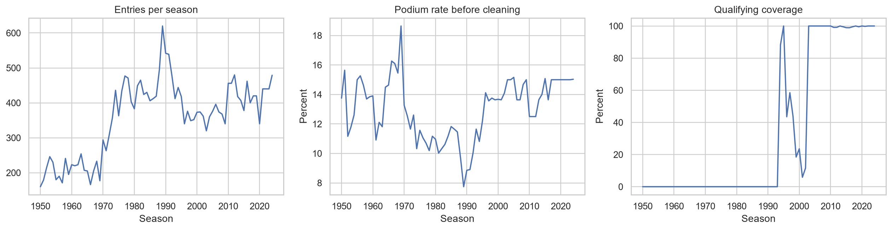

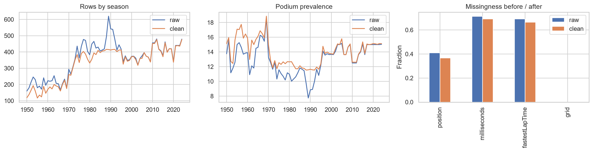

## 2. Three data-engineering answers

### Q1. Which circuits convert a front-row start into a podium?

Top eligible circuits in pre-2014: Circuit de Nevers Magny-Cours 82.9% (35 front-row starts); Istanbul Park 78.6% (14 front-row starts); Indianapolis Motor Speedway 78.6% (14 front-row starts).

Top eligible circuits in hybrid 2014-2021: Circuit of the Americas 92.9% (14 front-row starts); Circuit de Monaco 92.3% (13 front-row starts); Circuit de Barcelona-Catalunya 87.5% (16 front-row starts).

Top eligible circuits in ground effect 2022-2024: Autodromo Nazionale di Monza 100.0% (6 front-row starts); Suzuka Circuit 100.0% (6 front-row starts); Miami International Autodrome 100.0% (6 front-row starts).

| From | To | Shared circuits | Spearman rho |
| --- | --- | --- | --- |
| pre-2014 | hybrid 2014-2021 | 16 | -0.04 |
| hybrid 2014-2021 | ground effect 2022-2024 | 17 | -0.20 |
| pre-2014 | ground effect 2022-2024 | 17 | -0.24 |

| Era | Qualifying rows | Qual front row | Grid front row | Grid differs |
| --- | --- | --- | --- | --- |
| ground effect 2022-2024 | 1351 | 135 | 135 | 401 |
| hybrid 2014-2021 | 3229 | 318 | 318 | 1041 |
| pre-2014 | 5831 | 530 | 530 | 1039 |

The unit is a driver who actually started from grid 1 or 2. Rates use final podium outcomes only for the answer, never as pre-race predictors. The rank comparisons require ten front-row starts before 2022 and four in 2022-2024; wide intervals limit claims about the 2022-2024 ranking. Qualifying position is compared separately where recorded. The pre-2014 grid analysis spans all available historical starts; qualifying-only comparisons have changing coverage.

The shared-circuit rank correlations in the table are near zero or negative, so these observed rankings do change across eras. The small recent samples and overlap of intervals prevent a strong claim that individual circuits themselves became inherently more or less favorable.

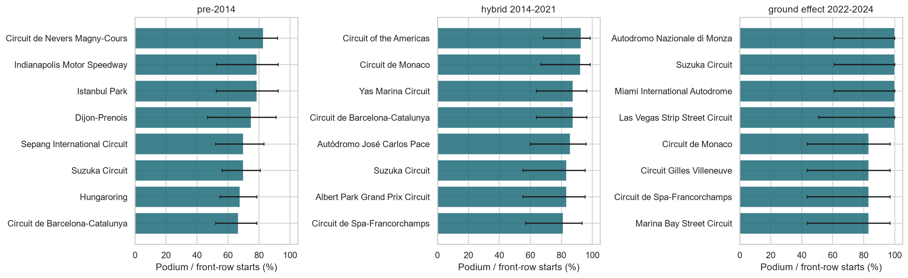

### Q2. Is a home race associated with more podiums after accounting for grid?

Among 24,534 classifiable starts (17 with ambiguous nationality excluded), 1,927 were home starts. Adjusting for grid bucket and era, the home indicator's odds ratio was 0.93 (race-clustered 95% CI 0.79-1.10). Standardized model probabilities were 13.1% at home and 13.7% away.

The confidence interval includes an odds ratio of 1, so these data do not show a clear home-podium advantage after the stated grid and era adjustment.

The unit is one cleaned driver-race start. British/UK and American/USA, among other demonyms, were mapped explicitly; mixed or unmapped nationalities were excluded. Grid strata control for starting position and era adjusts a major historical difference. Team strength, circuit familiarity and driver selection may still confound the comparison, so the association is not causal.

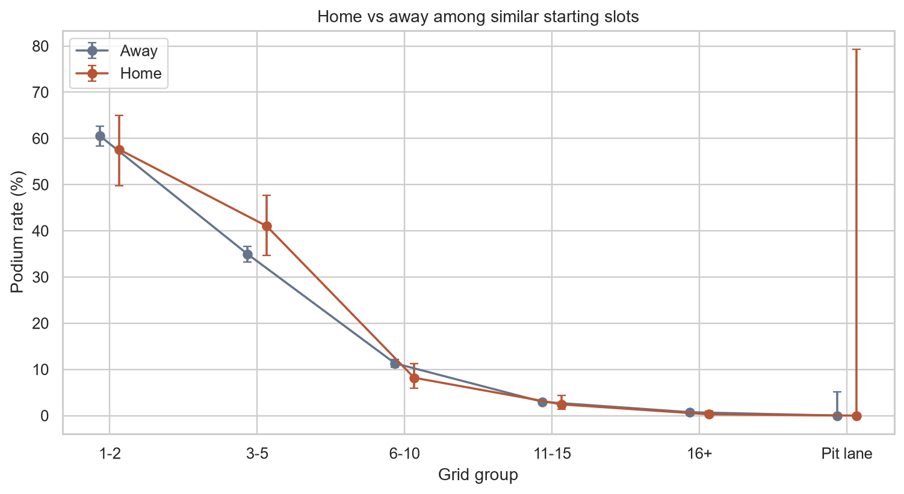

### Q3. Which constructors retire mechanically most often?

| Era | Constructor | Failures/starts | Rate | 95% CI | Ambig. | Upper rate |
| --- | --- | --- | --- | --- | --- | --- |
| 2014-2021 | Caterham | 7/33 | 21.2% | 10.7%-37.8% | 3 | 30.3% |
| 2014-2021 | Lotus F1 | 13/75 | 17.3% | 10.4%-27.4% | 5 | 24.0% |
| 2014-2021 | Toro Rosso | 39/242 | 16.1% | 12.0%-21.3% | 5 | 18.2% |
| 2022-2024 | Alfa Romeo | 10/88 | 11.4% | 6.3%-19.7% | 1 | 12.5% |
| 2022-2024 | Alpine F1 Team | 14/135 | 10.4% | 6.3%-16.7% | 0 | 10.4% |
| 2022-2024 | AlphaTauri | 6/88 | 6.8% | 3.2%-14.1% | 1 | 8.0% |

There were 89 ambiguous-status starts across 2014-2024. The main numerator includes explicitly named car-component and subsystem failures; collision, driver, regulatory and generic/uncertain retirements are excluded. Every actual race start remains in the denominator. Rankings require at least 20 starts per constructor-era; the notebook's status mapping and sensitivity upper rate show how ambiguous labels could change a result. Constructor IDs remain distinct across renames.

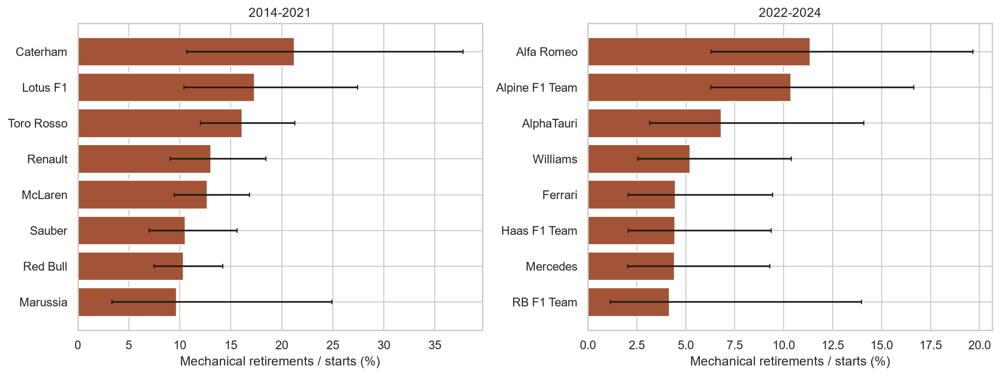

## 3. Features, cutoff and validation design

The modeling grain is one unique (raceId, driverId) starter from 2003-2024. Grid and qualifying fields are fixed before the main race. Driver form uses the previous five starts; constructor form first aggregates each previous race, then shifts by one constructor-race. Standings are taken from the latest strictly earlier round of the same season. Age, home indicator, race round and qualifying-entry count are pre-race context. Current-race results, status, points, laps, pit stops, same-race standings and sprint outcomes are excluded as features.

| Feature group | Fields | Pre-race rationale |
| --- | --- | --- |
| Grid | grid_position, pitlane_start | Grid-position EDA shows steep podium gradient; pit-lane zero is separate. |
| Qualifying | qual_position, grid_delta, qual_missing | Qualifying and grid can differ after penalties; coverage measured by year. |
| Driver form | driver_prior_starts, driver_podium_last5, driver_finish_last5 | Earlier-driver podium/finish histories may capture current form. |
| Constructor form | constructor_prior_races, constructor_podium_last5, constructor_finish_last5 | Prior car/team race outcomes may capture competitiveness. |
| Standings | driver_prev_rank, driver_prev_points, constructor_prev_rank, constructor_prev_points, driver_standing_missing, constructor_standing_missing | Only latest previous-round standing, never same-race standing. |
| Context | qualifying_field_size, age_years, race_round, is_home | Field size, age, round and home status are known before lights out. |

| Split | Years | Rows | Races | Podium rate |
| --- | --- | --- | --- | --- |
| train | 2003–2019 | 6780 | 321 | 14.2% |
| validation | 2020–2021 | 774 | 39 | 15.1% |
| test | 2022–2024 | 1351 | 68 | 15.1% |

No random split mixes future races into training. Imputation, clipping, log transformation and scaling are fitted on the training seasons only. Earlier held-out race outcomes may become legitimate history for later races; no held-out label changes model parameters or the chosen threshold.

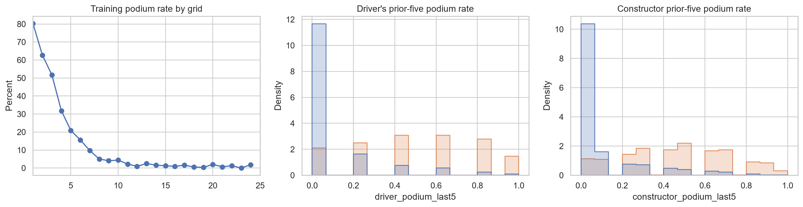

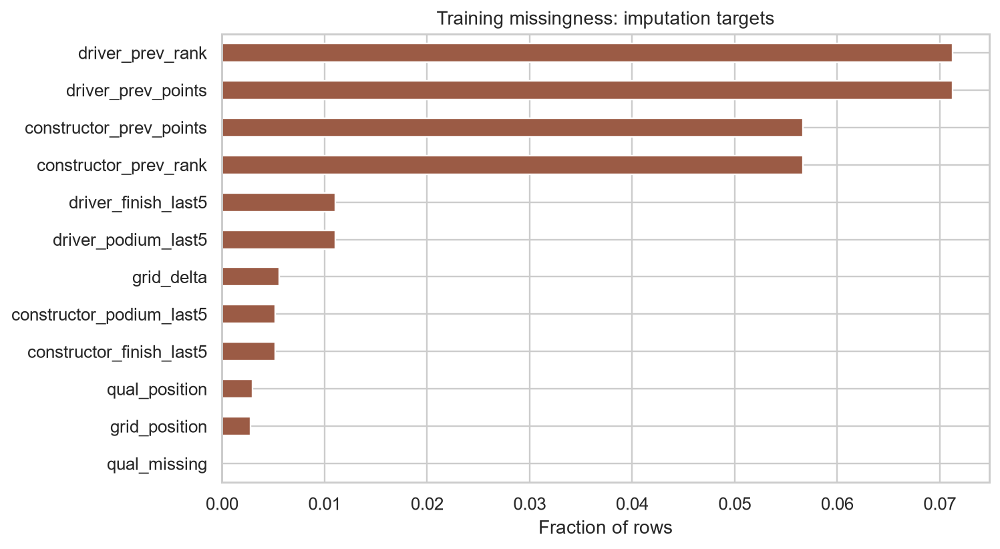

## 4. Models and controlled experiments

The simple baseline is logistic regression. Random forest, histogram gradient boosting and a one-hidden-layer feedforward neural network use the same rows and feature list. A small declared parameter grid is visible in the notebook; each family's best variant and its F1 threshold were selected on validation data. The overall winner was Logistic regression. Test metrics were computed only after those choices were fixed.

Logistic regression fits linear log odds and may miss interactions; it provides an interpretable baseline. Random forest averages bagged trees but can overfit. Gradient boosting adds trees sequentially and is sensitive to tuning and era drift. The one-hidden-layer neural network learns nonlinear combinations through backpropagation but needs scaling and can converge slowly. The shared split tests whether their extra flexibility improves ranking enough to justify complexity.

The selected neural-network variant reached its declared 160-epoch cap. Its validation and test scores are reported without claiming full optimizer convergence; the training-loss curve is included in the notebook.

| Model | Split | ROC-AUC | PR-AUC | F1 | Precision | Recall |
| --- | --- | --- | --- | --- | --- | --- |
| Logistic regression | train | 0.929 | 0.686 | 0.672 | 0.596 | 0.771 |
| Logistic regression | validation | 0.929 | 0.724 | 0.718 | 0.679 | 0.761 |
| Logistic regression | test | 0.936 | 0.709 | 0.669 | 0.579 | 0.794 |
| Random forest | train | 0.968 | 0.839 | 0.747 | 0.657 | 0.865 |
| Random forest | validation | 0.931 | 0.721 | 0.713 | 0.652 | 0.786 |
| Random forest | test | 0.933 | 0.708 | 0.668 | 0.569 | 0.809 |
| Gradient boosting | train | 0.972 | 0.856 | 0.772 | 0.779 | 0.765 |
| Gradient boosting | validation | 0.926 | 0.685 | 0.719 | 0.728 | 0.709 |
| Gradient boosting | test | 0.929 | 0.698 | 0.635 | 0.653 | 0.618 |
| Shallow NN | train | 0.943 | 0.729 | 0.694 | 0.597 | 0.829 |
| Shallow NN | validation | 0.926 | 0.719 | 0.705 | 0.639 | 0.786 |
| Shallow NN | test | 0.932 | 0.690 | 0.654 | 0.564 | 0.779 |

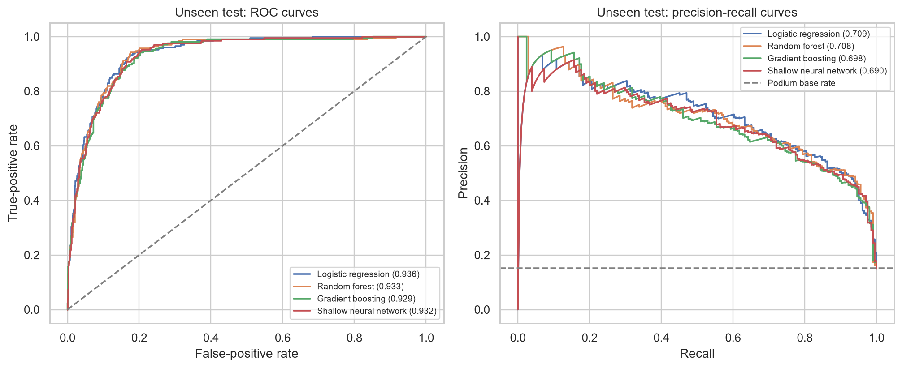

### Preprocessing order

| Experiment | Log before impute | Clip before impute | Validation PR-AUC | Validation F1 |
| --- | --- | --- | --- | --- |
| log/impute | True | True | 0.723 | 0.718 |
| log/impute | False | True | 0.724 | 0.718 |
| clip/impute | False | True | 0.724 | 0.718 |
| clip/impute | False | False | 0.724 | 0.718 |

The log/mean experiment changes how missing previous-points counts are filled. The clipping/mean experiment changes whether outliers affect the imputation mean. Both use a fixed logistic baseline and identical columns and rows. The winning orders were selected by validation PR-AUC, with all fitted quantities derived from train.

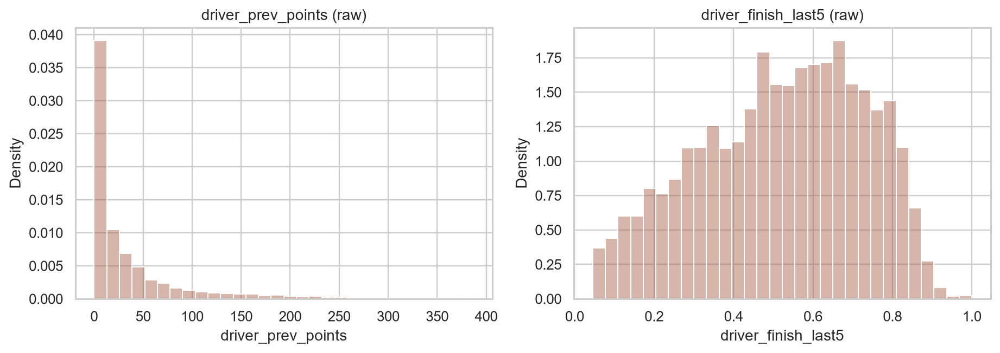

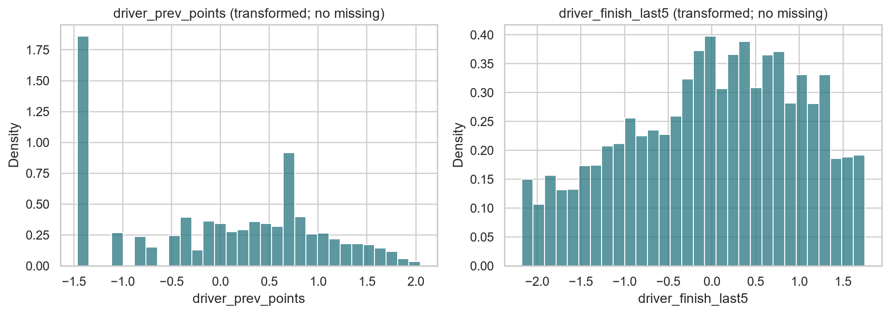

### Feature-group ablation

| Removed group | Features left | Validation PR-AUC | F1 | PR-AUC drop |
| --- | --- | --- | --- | --- |
| None (full model) | 21 | 0.724 | 0.718 | 0.000 |
| Grid | 19 | 0.723 | 0.712 | 0.000 |
| Qualifying | 18 | 0.713 | 0.699 | 0.011 |
| Driver form | 18 | 0.690 | 0.701 | 0.033 |
| Constructor form | 18 | 0.727 | 0.710 | -0.003 |
| Standings | 15 | 0.722 | 0.712 | 0.001 |
| Context | 17 | 0.723 | 0.697 | 0.001 |

Each row refits the selected family with the same settings and removes one group at a time. A negative drop means validation ranking improved when the group was removed; this is evidence about this fitted model, not a universal claim about that information.

Removing Driver form caused the largest validation PR-AUC decrease (0.033). The ablation plot also makes any redundant or harmful group visible; a near-zero change is not proof that the underlying information is unimportant in all models.

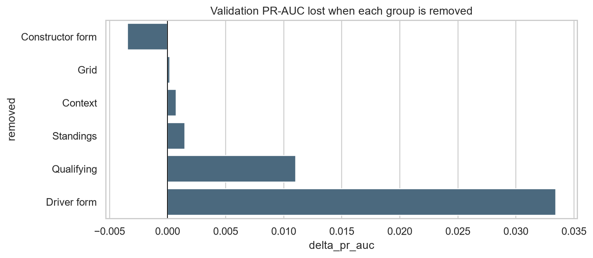

## 5. Global and local explanations

Permutation importance ranks qual_position, driver_prev_rank, driver_prior_starts highest by validation PR-AUC decrease. Mean absolute SHAP values on a bounded validation sample highlight qual_position, driver_prev_points, driver_prev_rank. These methods can split importance differently among correlated grid, qualifying, standings and form fields. Neither establishes that changing a field causes a podium.

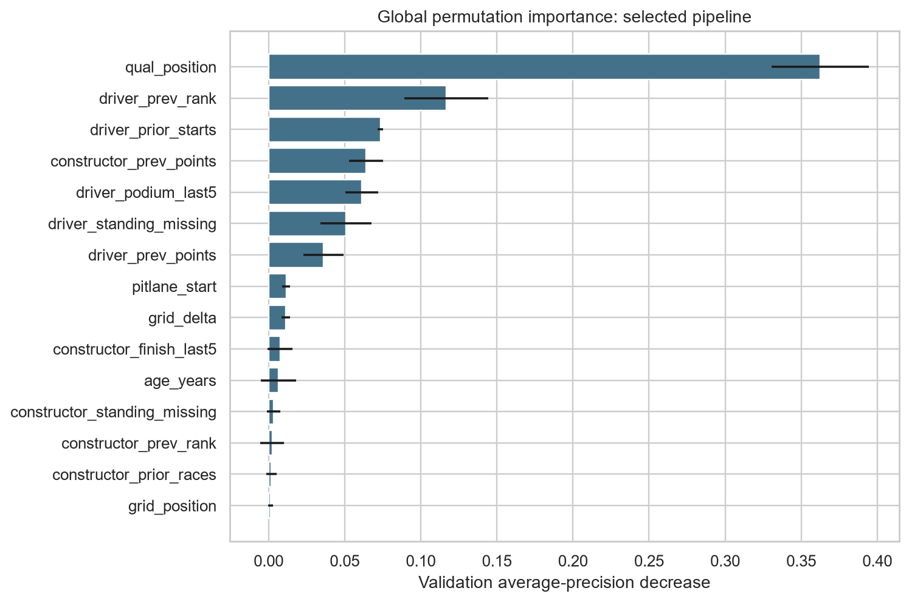

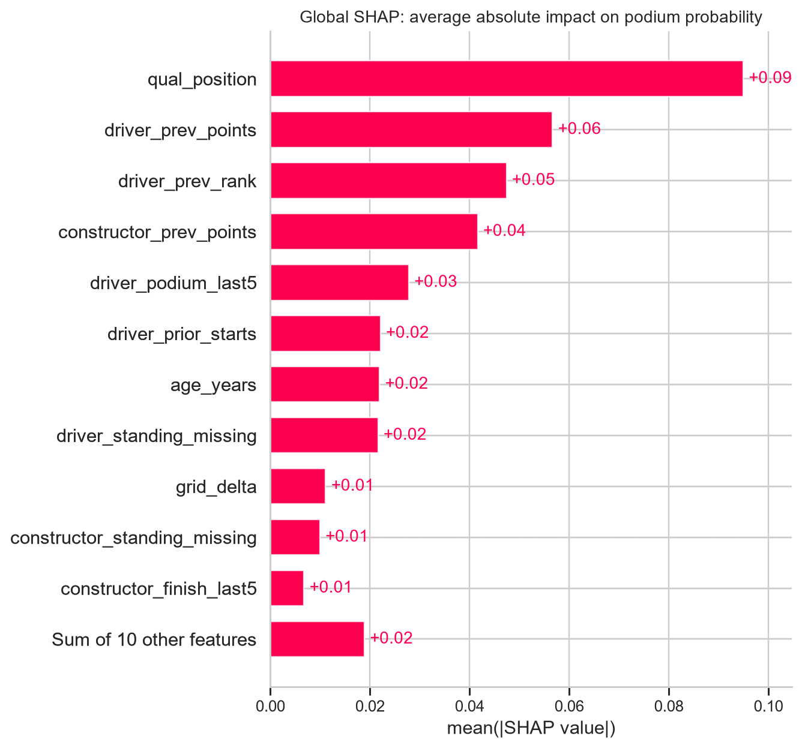

### One prediction

The local example is race 1075, driver 1, with actual podium label 0 and predicted probability 8.5%. The SHAP waterfall attributes movement from a training-background expectation to this prediction; LIME fits a local surrogate near the same input. The examples describe this model prediction, not race mechanics or causal effects.

For this case, SHAP's largest upward contributions are driver_podium_last5 (+0.070), driver_prior_starts (+0.067), driver_prev_rank (+0.043); the largest downward contributions are qual_position (-0.166), age_years (-0.050), driver_standing_missing (-0.021). The LIME bars show the corresponding local surrogate coefficients. Their values depend on the chosen background or local perturbations, so they should be read as explanations of this fitted prediction.

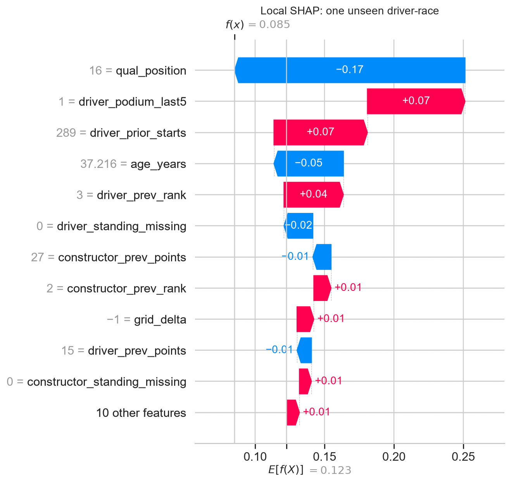

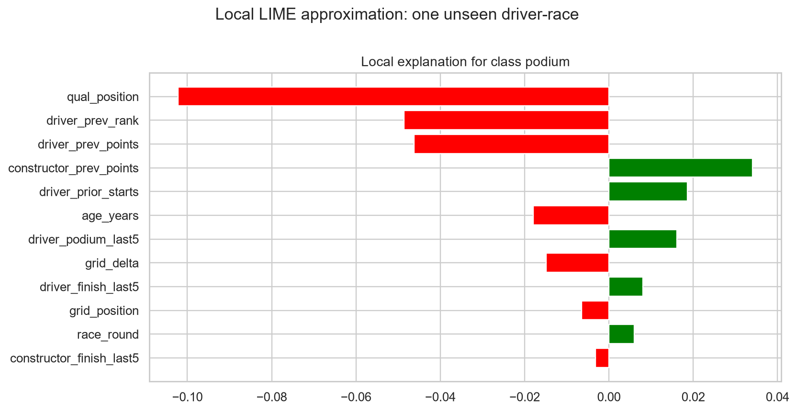

## 6. Inference and limits

The notebook's predict_podium(record) accepts only named engineered pre-race fields and applies the frozen training-fitted preprocessing and model, plus the validation threshold. A complete record returned probability 8.5% and label 0; with qualifying position, grid change and previous driver points omitted, it returned 17.9% and label 0. An unexpected or post-race field is rejected.

Limitations include pre-2003 qualifying drift, rule and car changes between train/validation and the 2022-2024 test era, constructor-identity resets at renames, uncertain mechanical-status labels, small home/front-row subgroups, class imbalance and the fact that the model is evaluated on actual starters. A genuine future deployment must reconstruct history only from races already completed at its cutoff.

Source: Rohan Rao, Formula 1 World Championship (1950-2024), Kaggle/Ergast, https://www.kaggle.com/datasets/rohanrao/formula-1-world-championship-1950-2020; milestone brief and the companion Formula 1 introduction supplied with this project. The full notebook, figures, data mapping, parameter attempts and output tables provide the reproducible evidence for this report.
